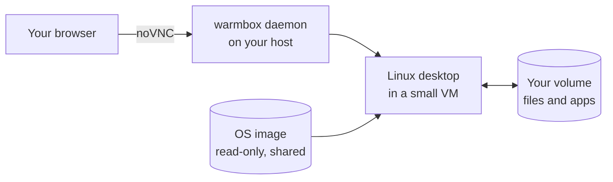

<div align="center">

# warmbox

**A Linux desktop you open in a browser tab.**

[](https://github.com/Daviduche03/warmbox/releases)
[](https://pypi.org/project/warmbox/)
[](LICENSE)

[Quick start](#quick-start) · [What you can do](#what-you-can-do) · [Images](#pick-an-operating-system) · [Volumes](#keep-your-desktop-on-a-volume) · [Docs](#docs)

</div>

warmbox runs small Linux virtual machines on a computer you control and streams
each desktop to your browser. There is nothing to install on the machine you are
sitting at.

Your files, settings and installed apps are saved to a volume. Keep that volume
in an S3-compatible bucket and you can start a desktop on your laptop today and
open the same one on a server next week.



> [!WARNING]
> warmbox is in beta. It runs on one host and assumes you trust that host. Don't
> put it on the open internet as it is. See [Good to know](#good-to-know) first.

## Quick start

You need macOS on Apple Silicon or Linux with KVM.

```sh
# 1. Install warmbox
curl -fsSL https://raw.githubusercontent.com/Daviduche03/warmbox/master/install.sh | sh

# 2. Install what it needs: the hypervisor, noVNC and a desktop image
warmbox setup

# 3. Run it in the background with one desktop kept ready
# (sudo it on macOS — the service runs as a system daemon so it can reach guests)
warmbox service install --pool 1
```

Then open <http://localhost:7070>.

1. Create an account. The first account owns the instance.
2. Press **New desktop**.
3. Your Linux desktop opens in the tab, usually in about a second.

`warmbox setup` is safe to run again. More install options, package managers and
updating are in [docs/install.md](docs/install.md).

## What you can do

| You want to | How |
|---|---|
| Get a desktop fast | warmbox keeps a few VMs booted and ready, so **New desktop** takes about a second. |
| Choose the operating system | `warmbox create --image lxqt` |
| Keep your work | Attach a volume. The desktop can be destroyed and your files stay. |
| Move to another computer | Store the volume in a bucket and attach it on another host. |
| Open a terminal inside it | `warmbox connect <id>` or `warmbox ssh <id>` |
| Run commands from code | Call the HTTP API, or use the Python or TypeScript client. |
| Share an app running inside | `/p/<vm>/<port>/` gives a port in the desktop a URL you can open. |
| Pause a desktop | Pause freezes it and Resume picks it up. Destroy frees the memory. |
| Go back to an earlier point | Snapshot a volume, then clone it into a fresh machine. |

## Everyday commands

```sh
warmbox login              # sign in once
warmbox create             # new desktop, prints its URL
warmbox list               # your desktops
warmbox connect <id>       # a terminal inside it
warmbox ssh <id>           # real SSH into it
warmbox history <id>       # what the guest has run
warmbox extend <id> --ttl 3600   # stop it by itself in an hour
warmbox destroy <id>       # remove it
warmbox help               # everything else
```

## Pick an operating system

| Image | What it is | Screen | Download | Boot time |
|---|---|---|---|---|
| `xfce` | Alpine + XFCE, the default | Yes | ~0.9 GB | ~1s ready, ~7s cold |
| `lxqt` | Alpine + LXQt | Yes | ~0.9 GB | ~7s |
| `headless` | Alpine with no desktop | No | ~0.15 GB | ~6s |
| `omarchy` | Arch + Hyprland, macOS hosts only | Yes | ~3.9 GB | ~13s |

Sizes and times are approximate and were measured on an Apple Silicon host.

```sh
warmbox images                    # what you can boot right now
warmbox create --image lxqt       # pick one
warmbox create --image headless   # no screen, driven through the API
```

To build, download, move or add your own image, see
[docs/images.md](docs/images.md).

## Keep your desktop on a volume

A volume is the disk of your machine. It holds your files and installed apps.

```sh
warmbox volume create dev --size 8G   # make a disk
warmbox create --volume dev           # boot a desktop on it
warmbox snapshot create dev           # freeze it at this point
warmbox volume clone dev dev-clean    # a fresh machine from that point
```

Volumes are stored on the host by default. To use the same disk on another
computer, keep volumes in a bucket:

```sh
warmbox cloud set --endpoint https://<account>.r2.cloudflarestorage.com \
  --access-key <KEY> --secret-key <SECRET> --bucket <BUCKET>
warmbox service restart
```

You can set this under **Settings** in the dashboard too. More in
[docs/volumes.md](docs/volumes.md).

## Use it from code

Every desktop runs a small agent, so you can run commands and move files over
HTTP with no SSH keys and no screen.

```sh
curl -X POST localhost:7070/api/desktops/$ID/exec -d '{"cmd":"uname -a"}'
curl "localhost:7070/api/desktops/$ID/files?path=/home"
curl "localhost:7070/api/desktops/$ID/file?path=/etc/hostname"
```

| Client | Install |
|---|---|
| [Python](sdk/python) | `python -m pip install warmbox` |
| [TypeScript](sdk/typescript) | From this checkout until its first npm publish |

Each client README has a full create, run and destroy example. The API can run
background jobs and interactive sessions too, and all of it is in
[docs/agent-api.md](docs/agent-api.md).

## Where it runs

| Host | `xfce`, `lxqt`, `headless` | `omarchy` |
|---|---|---|
| macOS 13+ on Apple Silicon | ✅ | ✅ |
| Linux + KVM, x86_64 | ✅ verified | ❌ |
| Linux + KVM, arm64 | ✅ expected, untested | ❌ |
| Intel Mac | ❌ | ❌ |
| Windows | ❌ not yet | ❌ |

## How finished is it

| Status | What |
|---|---|
| Solid and used daily | XFCE and LXQt desktops, the ready pool, accounts and workspaces, volumes with snapshots and clones, image build, pack and pull, running commands and moving files through the API |
| Solid on Linux only | Memory checkpoints: `checkpoint`, `restore`, `hibernate` and `wake` |
| Experimental | `warmbox-app` and the `/p/` port proxy |
| Not built yet | Screenshots and input through the API, `omarchy` outside macOS, memory checkpoints on macOS, GPU and audio |

## Good to know

- The dashboard is plain HTTP unless you give it a certificate, so it only
  listens on your own machine by default. To reach it from elsewhere, follow
  [docs/remote-access.md](docs/remote-access.md).
- Everything inside a desktop runs as root.
- A volume attaches to one desktop at a time.
- Desktops have no GPU and no audio.
- Images are large downloads. `omarchy` is about 3.9 GB.

The details are in [docs/limitations.md](docs/limitations.md).

## Docs

| Guide | What it covers |
|---|---|
| [Install](docs/install.md) | The installer, package managers, updating |
| [Running it](docs/running.md) | The background service, memory use, where files live |
| [Remote access](docs/remote-access.md) | Tailscale, TLS, SSH tunnel |
| [Images](docs/images.md) | Build, download, move and add images |
| [Volumes](docs/volumes.md) | Volumes, sizing, API |
| [Snapshots](docs/snapshots.md) | Snapshots and the fast resume plan |
| [Agent API](docs/agent-api.md) | Running commands, files, sessions |
| [HTTP API](docs/api.md) | The API: answers, paging, retries, creating desktops |
| [Egress](docs/egress.md) | Controlling what a desktop can reach on the network |
| [Limitations](docs/limitations.md) | What it can't do yet, in detail |
| [Architecture](docs/architecture.md) | How volumes and snapshots are designed |
| [Development](docs/development.md) | Build from source, code layout, releases |
| [Omarchy image](deploy/omarchy/README.md) | The Arch + Hyprland image |

## Contributing

Help is welcome. Start with [CONTRIBUTING.md](CONTRIBUTING.md). These are the
areas where it would count most:

- Omarchy-style images on Linux servers
- A ready pool for every image, since only the default image is kept ready today
- A Cloud Hypervisor or Firecracker backend
- Screenshots and input in the agent API
- WebRTC streaming in place of noVNC
- Windows support
- API and VM lifecycle tests

## License

[Apache 2.0](LICENSE)
